# ArgoCD GitOps on Ministack AWS EKS 項目

## 一、項目簡介
### 建立 ArgoCD GitOps on Ministack AWS EKS 的 MVP (最小可行產品)

0. **Vagrant (可選)**: 虛擬機管理工具，用來建立部署虛擬的開發環境，**這邊創建虛擬開發環境，並和本機環境隔離**
1. **Ministack**: 免費開源 AWS 模擬器，在 LocalStack 老牌AWS模擬器後面轉收費後，推出的免費開源 AWS 模擬器，免註冊帳號和獲取授權token，為 LocalStack Community 的免費替代方案，**這邊使用 Ministack 在本地啟Docker容器建立一個模擬AWS API，搭配 Terraform 搭建AWS EKS集群**
2. **Terraform**：開源的基礎設施即代碼（IaC，Infrastructure as Code）工具，**這邊使用 Terraform + AWS Provider 來創建管理AWS基礎設施資源**
3. **AWS CLI**: AWS 命令行開源工具，可以使用命令行shell 中的命令與 AWS 服務進行交互
4. **Helm**: Kubernetes(K8s)的開源套件管理工具，**這邊前面使用 Helm Chart 快速搭建 ArgoCD**，非常適合用在搭建K8集群中複雜的應用服務
5. **ArgoCD**: 運行在Kubernetes 集群的 GitOps 持續部署(CD，Continuous Deployment)工具，**這邊使用 ArgoCD + GitHub Repository 來實踐GitOps，用 GitHub Repository 作為 "單一可信任資料來源(Single Source of Truth)" 進行管理和自動化部署的 DevOps 運維工作流**


>結合之前 GitHub Workflow 項目的持續交付 (CI，Continuous Delivery)，GitHub Action Pipeline 代碼自動化測試、集成打包docker image鏡像推送到 GHCR (GitHub Container Registry) 免費鏡像倉庫，**這邊使用 GHCR 作為部署 K8s Deployment 的鏡像源**


## 二、項目背景
用免費開源、最低成本的方式來搭建開發環境，學習 ArgoCD GitOps 工作流和 Ministack 模擬AWS EKS搭建，以 ArgoCD + GitHub Repository 為實踐場景，建立 "單一可信任資料來源(Single Source of Truth)" 進行管理和自動化部署的 DevOps 運維工作流


## 三、項目架構

1 - 6 : MiniStack EKS K3s集群搭建   
7 - 8 : Helm 安裝 ArgoCD，ArgoCD 核心組件介紹   
9 - 10: ArgoCD 項目管理架構  
(使用 **draw.io** 畫圖展示)

### 1. MiniStack 模擬 EKS 官方架構
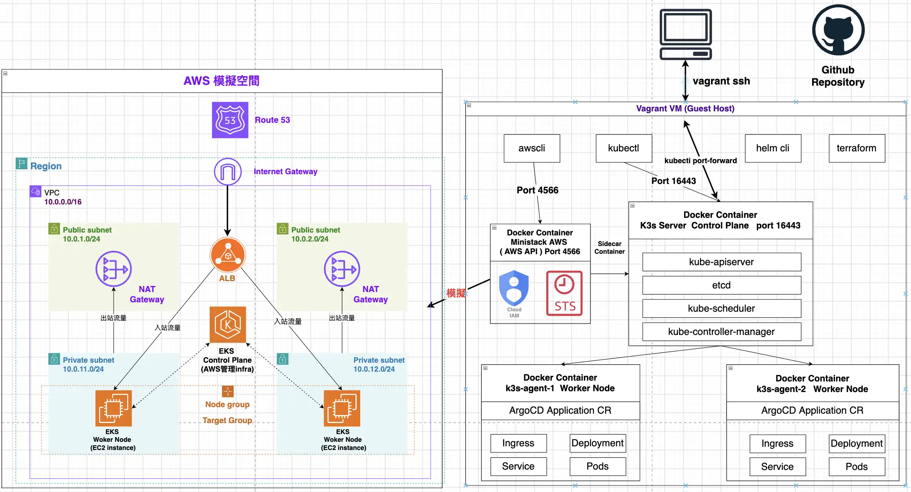

MiniStack 是 AWS API 模擬器，而 k3s Server 是由 MiniStack 動態建立的獨立 Docker Sidecar Container

兩者不是部署在同一個 Container 裡面的兩個進程，也不是 Kubernetes Pod 內的傳統 Sidecar Container

**MiniStack 透過 Docker Socket 呼叫 Docker Daemon 操作 Docker Host，建立及管理 k3s Server Container，來模擬 AWS EKS 的 Kubernetes Cluster**

### 2. MiniStack 啟動 Container 

```markdown
# 啟動完後，可以確認 ministack health 接口   
> curl -v http://localhost:4566/_ministack/health

# Ministack API endpoint 默認端口 4566 
# 後面 `aws cli` 模擬調用 `AWS API` 都要指定到 `Ministack API endpoint` 
```
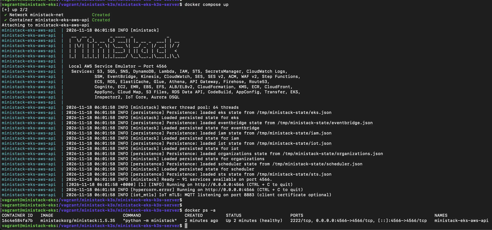

### 3. 設置 MiniStack 測試用 AWS Credentials

```markdown
# Access Key ID 和 Secret Access Key 是長期憑證 
# 正式環境不可以公開，有安全風險
export AWS_ACCESS_KEY_ID=test
export AWS_SECRET_ACCESS_KEY=test
export AWS_DEFAULT_REGION=ap-southeast-1

# 查看 AWS Credentials 是否有成功設置
aws configure list

# AWS CLI 調用 AWS 基礎服務 API，測試 Ministack API (模擬AWS API endpoint)
# STS
aws --endpoint-url=http://localhost:4566 sts get-caller-identity
# IAM
aws --endpoint-url=http://localhost:4566 iam list-roles
# VPC
aws --endpoint-url=http://localhost:4566 ec2 describe-vpcs
# EKS
aws --endpoint-url=http://localhost:4566 eks list-clusters
# Load Balancers
aws --endpoint-url=http://localhost:4566 elbv2 describe-load-balancers
# Route53
aws --endpoint-url=http://localhost:4566 route53 list-hosted-zones

# AWS Credentials 沒設置成功，aws-cli 無法成功驗證通過，並調用 AWS API
> aws: [ERROR]: An error occurred (NoCredentials): Unable to locate credentials. You can configure credentials by running "aws login".
```

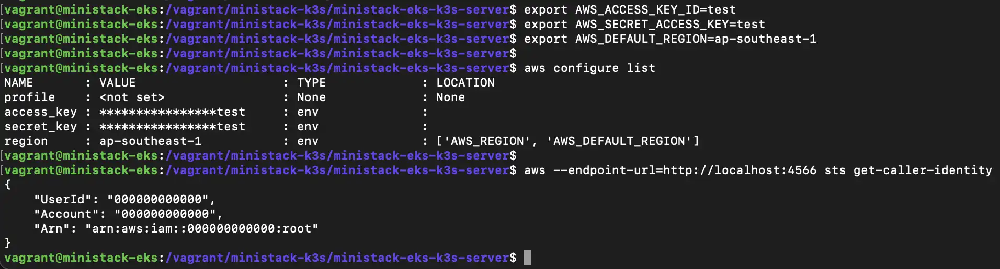


### 4. Terraform 創建 AWS infrastructure 資源

```markdown
# terrraform 初始化，下載 provider plugin 供應商套件, modules模塊等
# AWS Provider 供應商套件去操作調用AWS API
terraform init
# 驗證 Terraform HCL語法是否正確
terraform validate
# 調用AWS API，本地模擬創建AWS resource、modules 等依賴關係(dry-run)
terraform plan
# 調用AWS API，實際創建AWS服務等資源(注意：調用真實AWS API創建資源，可能會產生費用)
terraform apply

> Ministack 動態建立及管理 k3s Server Container，來模擬 AWS EKS 的 Kubernetes Cluster
```
#### terraform init 和 terraform validate
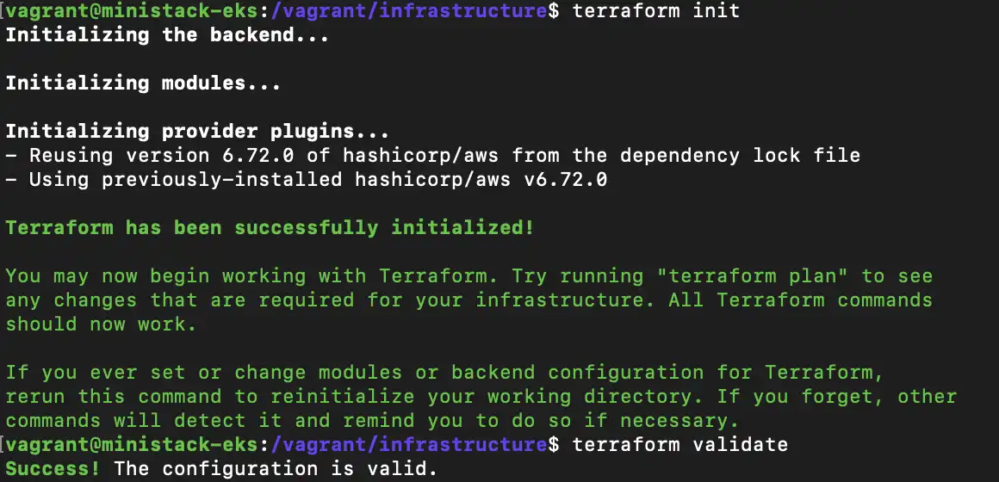

#### terraform plan
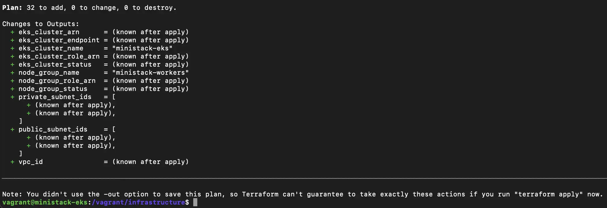

#### terraform apply，K3s Server - Kubernetes Control Plane (Master Node) 已成功創建
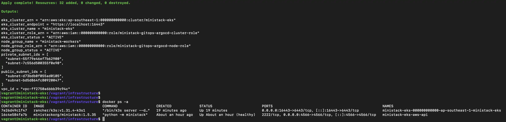


### 5. 客戶端 kubeconfig 文件，kubectl 透過本地讀取kubeconfig，連線上 AWS EKS集群

```markdown
# 查看 AWS EKS Cluster
aws --endpoint-url=http://localhost:4566 eks list-clusters
# 更新生成 kubeconfig 文件
aws --endpoint-url=http://localhost:4566 eks update-kubeconfig --region ap-southeast-1 --name ministack-eks
# 查看 kubeconfig 文件
kubectl config view

# kubectl 透過本地讀取 kubeconfig文件 (`~/.kube/config`)，連線操作AWS EKS集群

# 過程：CLI → kubeconfig → HTTPS/TLS → kube-apiserver → Authentication → Authorization → Admission → API handler → etcd → Response

# 如果 kubeconfig 沒有更新成功，可能在一層層的驗證中失敗
> Unable to connect to the server: tls: failed to verify certificate: x509: certificate signed by unknown authority 
```

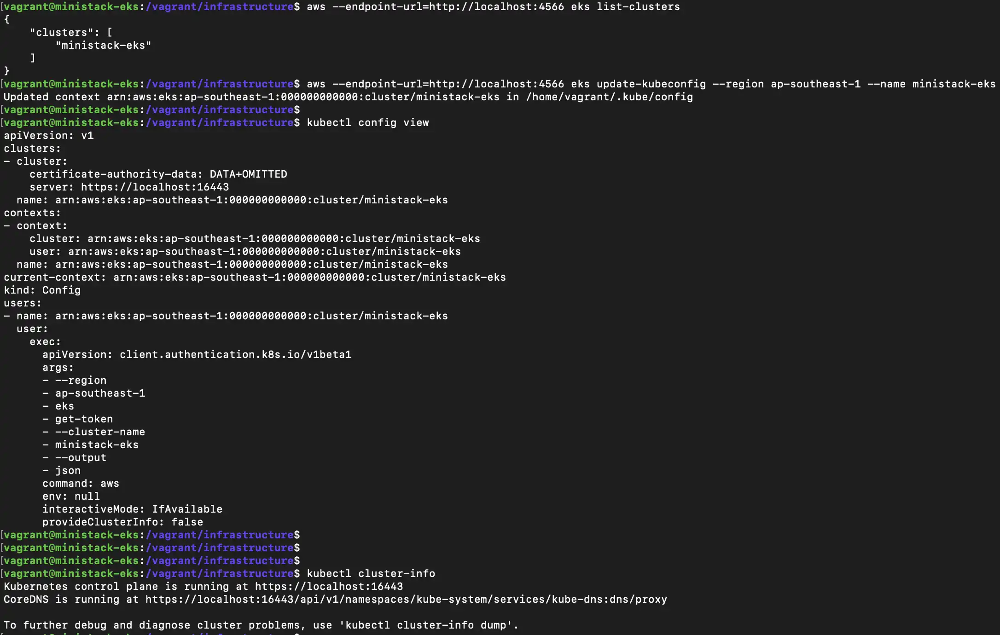

### 6. 創建 Worker Node (k3s agent)，K3s Agents 透過 K3s Server 的Node Token(Bootstrap Token)機制驗證 join 到Kubernetes集群 Control Plane

```markdown
# 查看 K3s Server Control Plane IP
kubectl get nodes -o wide
# 查看 K3s Node Token (Bootstrap Token，是 Worker Node join到集群管理用)
docker exec ministack-eks-000000000000-ap-southeast-1-ministack-eks cat /var/lib/rancher/k3s/server/node-token
# 編輯 `.env`
# 創建 k3s Agent - Worker Node
docker compose --env-file .env -f docker-compose.yml up -d
```
#### 查看 K3s Server Control Plane IP 和 K3s Node Token (這時候Worker Node還沒有join進來)
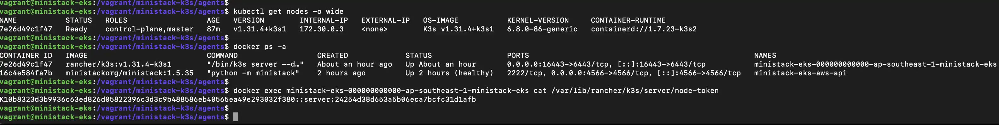

#### 編輯 `.env`
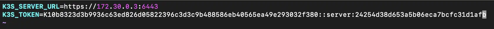

#### 創建 k3s Agent - Worker Node (Worker Node 成功地 join到 Kubernetes集群)
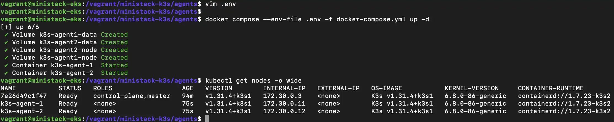


---

### 7. 使用 Helm 安裝 ArgoCD，登入 ArgoCD admin Web

```markdown
# 加入 Argo Helm Repository
helm repo add argo https://argoproj.github.io/argo-helm
helm repo update
# 查看 Helm Repository list (Helm 3 默認一開始是空的)
helm repo list 
# 確認 Chart
helm search repo argo/argo-cd
# 建立 Namespace `argocd`
kubectl create namespace argocd
# 查看 namespaces 
kubectl get namespaces
kubectl get namespace argocd
# 使用 Helm 安裝，默認配置
helm install argocd argo/argo-cd --namespace argocd
# 查看ArgoCD Web UI 的密碼(管理員密碼保存在 secret argocd-initial-admin-secret)
kubectl -n argocd get secret argocd-initial-admin-secret -o jsonpath="{.data.password}" | base64 -d
# 用 kubectl port-forward 命令，本機端口8080 forward到 k8s svc/argocd-server 443 
kubectl port-forward svc/argocd-server -n argocd 8080:443 

# 本機瀏覽器訪問 ArgoCD Web UI https://localhost:8080/ 
```
##### Helm 安裝 ArgoCD


##### ArgoCD Web UI https://localhost:8080/
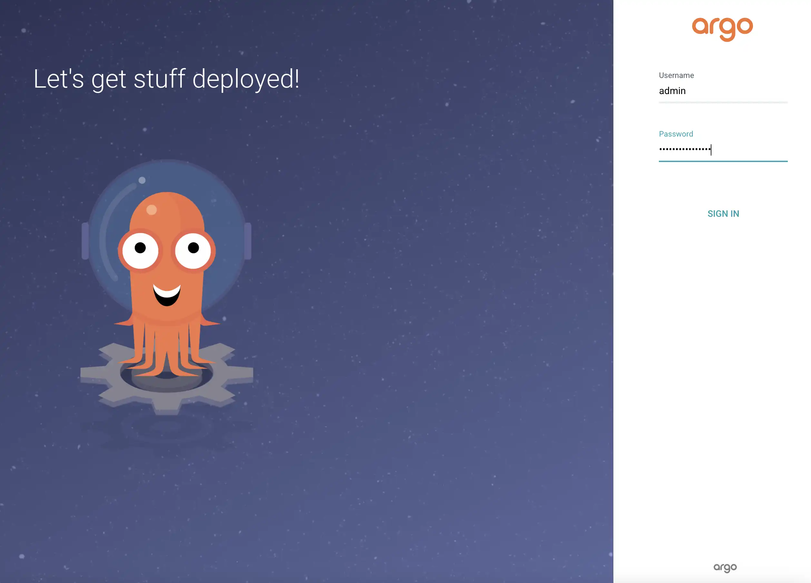

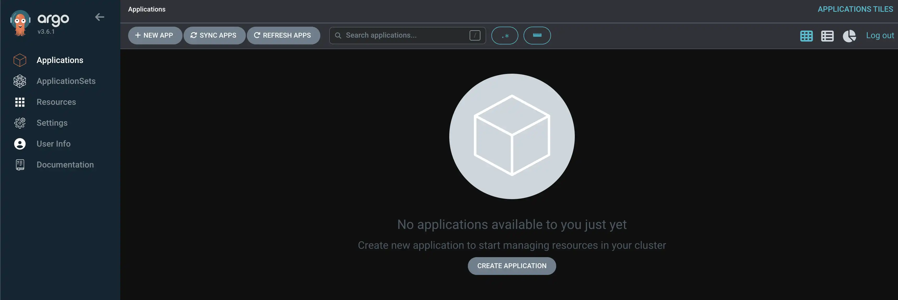


### 8. ArgoCD 核心組件
#### ArgoCD 的 K8s Workload
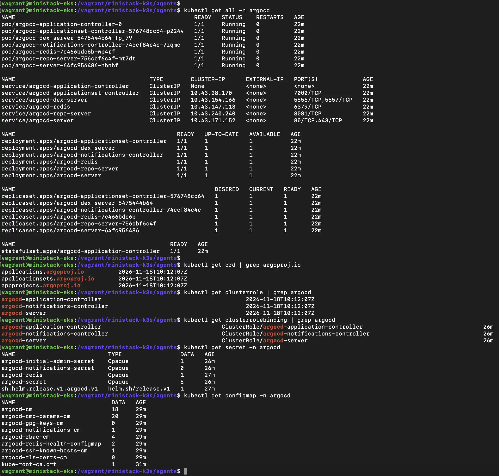

**Argo CD 採用 Kubernetes Controller 架構，並透過 Kubernetes API Server、CustomResourceDefinition（CRD）及 Reconciliation Loop 實現 GitOps**

#### 1. argocd-server（API Server）
- 提供 gRPC / REST API
- 提供 Web UI
- 處理 CLI、UI、CI/CD 請求
- 管理使用者認證、授權及 RBAC

#### 2. argocd-application-controller
- Argo CD 最核心的 Controller
- Watch Application CR
- 比較 Git Desired State 與 Cluster Live State
- 判斷 OutOfSync、Synced、Healthy、Degraded
- 執行自動或手動 Sync

#### 3. argocd-repo-server
- 連接 Git Repository
- Clone / Fetch Git Repository
- 支援 Kubernetes YAML、Helm、Kustomize
- 執行 Manifest Generation
- 回傳產生的 Kubernetes Manifest 給 Application Controller

#### 4. argocd-redis
- 快取 Application 狀態
- 快取 Repository 相關資料
- 降低重複存取 Git 及 Kubernetes API 的負擔
- 提升 UI 與 API 查詢效率

#### 5. argocd-applicationset-controller
- 監控 ApplicationSet CR
- 透過 Generator 產生 Application 
- 支援 Git、List、Cluster、Matrix 等 Generator
- 適合大量應用服務及多 Cluster 部署

#### 6. argocd-dex-server（可選）
- 提供外部 OIDC 身分認證整合
- 可整合 LDAP、GitHub、企業身分提供者等
- 也可以使用其他 OIDC 整合方式

#### 7. argocd-notifications-controller（可選）
- 監控 Application 狀態變化
- 發送 Slack、Email、Webhook 通知
- 通知部署成功、失敗及同步狀態

### 9. ArgoCD 三個主要註冊在集群的自定義資源 CRD (Custom Resource Definitions)

#### Application: 
- 定義單一應用程序的Git Repo 來源庫(`source`)、目標集群(`destination`)與同步策略(`syncPolicy`)

#### ApplicationSet: 
- 透過模板(`template`)與產生器(`generators`)，批量自動產生多個 Application 資源，常用於多集群與多環境部署

#### AppProject: 
- 提供邏輯隔離與權限邊界，限制Application可存取的 Git Repo (`sourceRepos`)、目標集群(`destination`)與允許建立的 K8s 資源類型等權限白名單(`ResourceWhitelist`)。


### 10. ArgoCD App of Apps Pattern架構 + ApplicationSet 和目錄架構

#### App of Apps Pattern架構
1. **Root Application**: 管理 AppProject 和 Child Applications
2. **Child Application**: 管理應用程序的 Helm Chart / Kubernetes YAML
3. **Kubernetes**: 管理應用程序的 Workload，Ingress、Service、Deployment、Pod

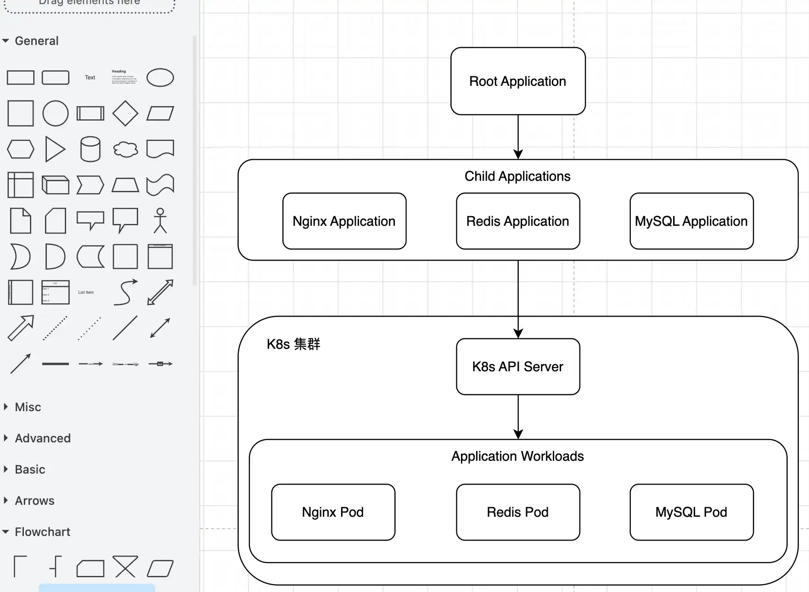

#### App of Apps Pattern架構 + ApplicationSet 自動生成 Child Apps 
1. **Root Application**: 管理 AppProject、ApplicationSet
2. **ApplicationSet**: 使用template 和 generators 自動生成 Child Applications
3. **Child Application**: 管理應用程序的 Helm Chart / Kubernetes YAML
4. **Kubernetes**: 管理應用程序的 Workload，Ingress、Service、Deployment、Pod


#### 項目目錄架構 

```bash
argocd
├── apps                         
│   └── python-fastapi
│       ├── deployment.yaml
│       ├── ingress.yaml
│       └── service.yaml
├── argocd-config
│   ├── applicationsets
│   │   ├── apps-applicationset.yaml
│   │   └── platform-applicationset.yaml
│   └── projects
│       ├── apps-project.yaml
│       └── platform-project.yaml
├── bootstrap
│   └── root-app.yaml
└── platform
    ├── envoy-gateway
    │   ├── config
    │   └── values.yaml
    ├── ingress-nginx
    │   └── values.yaml
    └── metrics-server
        └── values.yaml
```
**Root Application**   
- `bootstrap/root-app.yaml` : Root Application 管理 argocd-config 目錄. 

**AppProject**    
- `argocd-config/projects/platform-project.yaml` : 定義 platform Child Application 權限範圍限制白名單

- `argocd-config/projects/apps-project.yaml` : 定義 apps Child Application 權限範圍限制白名單

**ApplicationSet**   
- `argocd-config/applicationsets/platform-applicationset.yaml` : 定義 platform ApplicationSet，設置 Child Application 模板

- `argocd-config/applicationsets/apps-applicationset.yaml` : 定義 apps ApplicationSet，設置 Child Application 模板

**Child Application** 
- platform 目錄：基礎平台應用服務，這邊使用 Helm 來安裝基礎平台應用服務，直接像前面安裝ArgoCD一樣
- apps 目錄：業務應用服務apps 的 K8s資源YAML，這邊使用之前GitHub Workflow CI/CD 項目打包的鏡像，推送到鏡像倉庫GHCR


## 四、ArgoCD GitOps on Ministack AWS EKS 項目啟動和測試

```markdown
# 創建 Root Application CR 
kubectl apply -f root-app.yaml
# 查詢 命名空間 argocd 下的 applications
kubectl get applications -n argocd

## 也可以透過本機瀏覽器訪問 ArgoCD Web UI https://localhost:8080/ 來查看ArgoCD、K8s資源狀況
```

#### 創建 Root Application CR 
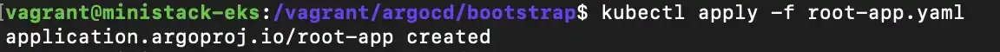

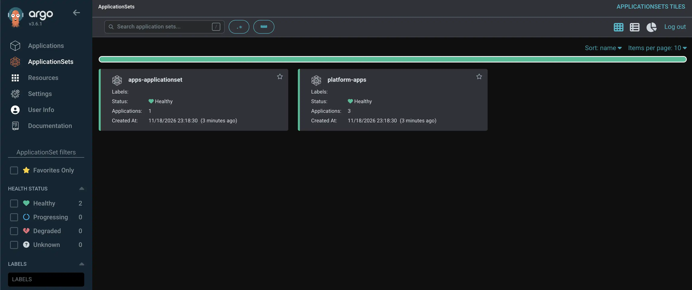

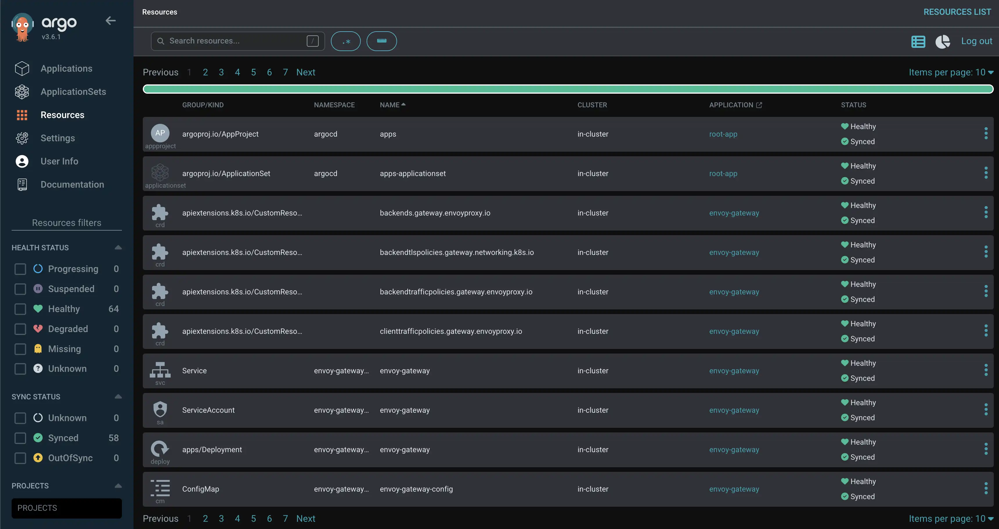

#### 嘗試擴容Pod數量，將Git Repository上 Deployment YAML的 spec.replicas 從 4 -> 6 
> Application 的 Sync Policy 有設置 Auto-Sync，也可以手動自己在ArgoCD Web 點擊 STNC 同步state


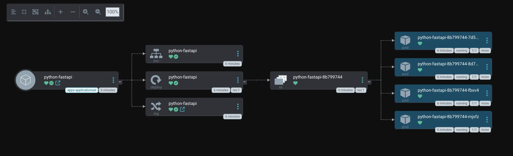

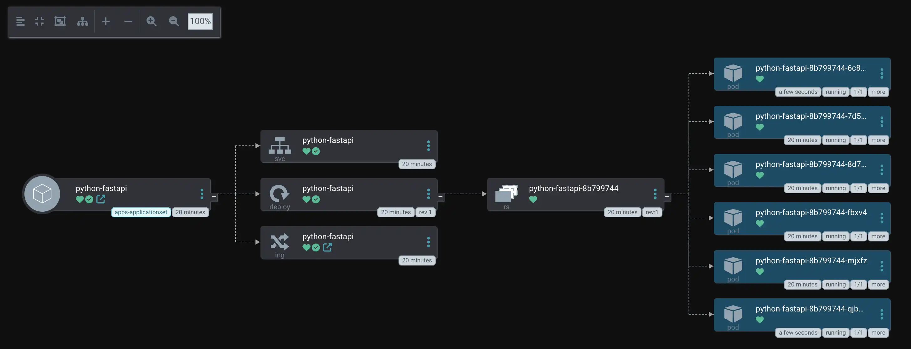

#### 測試部署在K8s集群中的應用程序的API接口
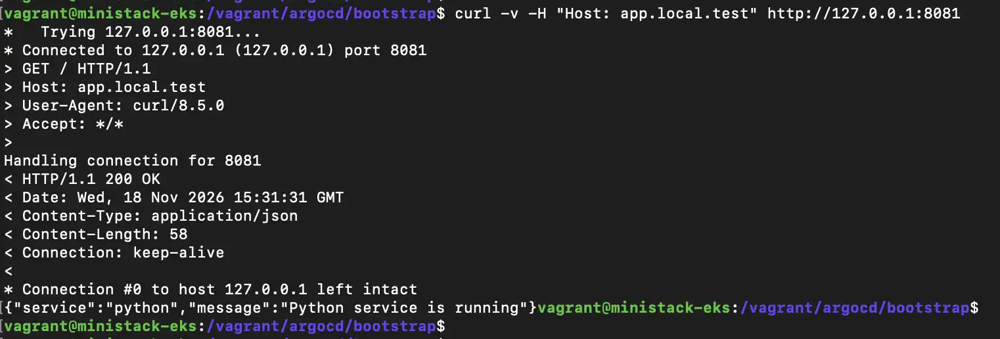

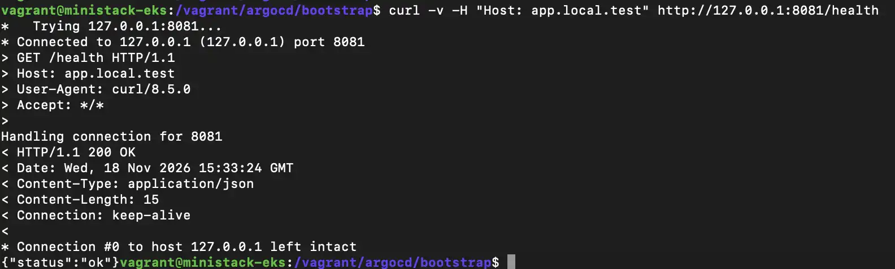

#### 測試 ArgoCD + Helm 部署的 Metrics Server
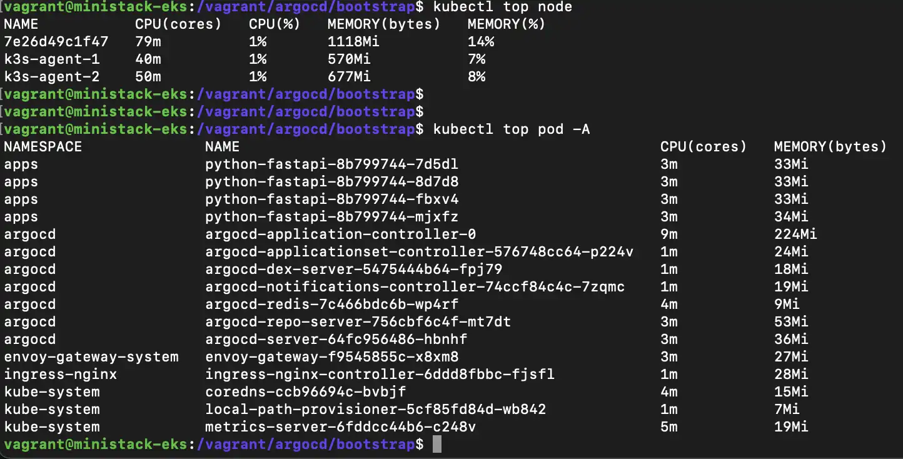